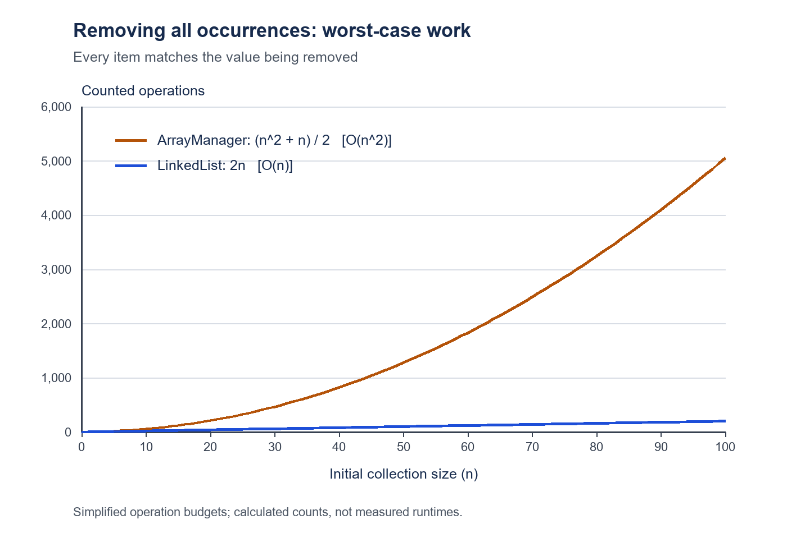

# Algorithm Efficiency Analysis

## ArrayManager

When an item matches, the array method shifts the items after it one position to the left. The worst case is when every item matches.

For example, removing 4 from `{4, 4, 4, 4, 4}` requires 5 match checks and `4 + 3 + 2 + 1 = 10` shifts. That gives 15 counted operations.

For n items:

`n match checks + n(n - 1) / 2 shifts = (n^2 + n) / 2`

The worst-case runtime is **O(n^2)** because the number of shifts grows with n squared.

## LinkedList

The linked list method visits each node once. It removes a matching node by changing the link before it, or moving the first-node reference. No items need to be shifted.

For the same example, there are 5 match checks and 5 changes to the first-node reference. That gives 10 counted operations.

For n items, there are n match checks and at most n link or first-node reference changes:

`n + n = 2n`

The worst-case runtime is **O(n)** because the work grows directly with the number of nodes.

## Comparison

The array method has the worse worst-case runtime: **O(n^2)** compared with **O(n)** for the linked list.

These approximate counts include match checks and array shifts or link changes. They leave out loop control, traversal, count changes and current updates, which add linear work. Integer match checks take constant time.

| Number of items (n) | ArrayManager | LinkedList |
| --- | --- | --- |
| 10 | 55 | 20 |
| 20 | 210 | 40 |
| 50 | 1,275 | 100 |
| 100 | 5,050 | 200 |

The graph shows these calculated counts when every item matches. It does not show measured execution times.
